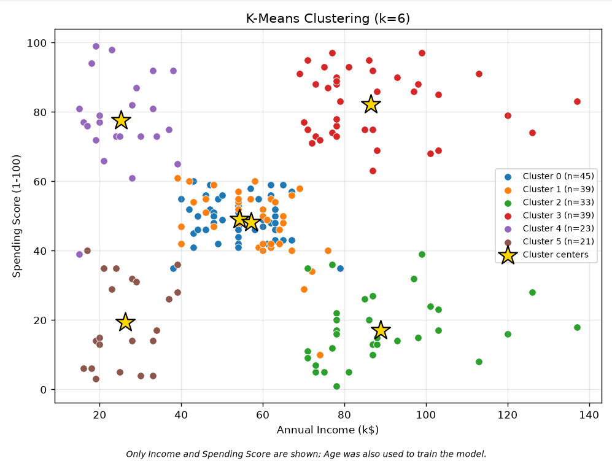

# Customer Segmentation 📊

A beginner-friendly Machine Learning project that groups customers based on their age, annual income, and spending score using three unsupervised clustering algorithms.

## 🚀 Algorithms

- **K-Means** — partitions customers into clusters based on distance.
- **Hierarchical Clustering** — builds customer groups using hierarchical relationships.
- **DBSCAN** — identifies density-based clusters and detects outliers.

## ✨ Features

- Data preprocessing and feature scaling
- Cluster evaluation and algorithm comparison
- Elbow Method and parameter selection visualizations
- Customer cluster profiles and business insights
- Interactive terminal menu
- Individual customer cluster exploration

## 📈 Clustering Results

The following plots show the customer clusters generated by each algorithm.

<p align="center">
  
  
  
</p>

## 📊 Evaluation & Customer Profiles

<p align="center">
  
  
</p>

## 🛠️ Technologies

Python · Pandas · NumPy · Scikit-learn · Matplotlib · SciPy

## ⚙️ Installation & Usage

Install the required libraries:

```bash
pip install pandas numpy scikit-learn scipy matplotlib
```

Place `Mall_Customers.csv` in the same directory as `main.py`, then run:

```bash
python main.py
```

## 🎯 Goal

Explore customer segments, compare clustering algorithms, and identify meaningful customer groups to support data-driven marketing decisions.
